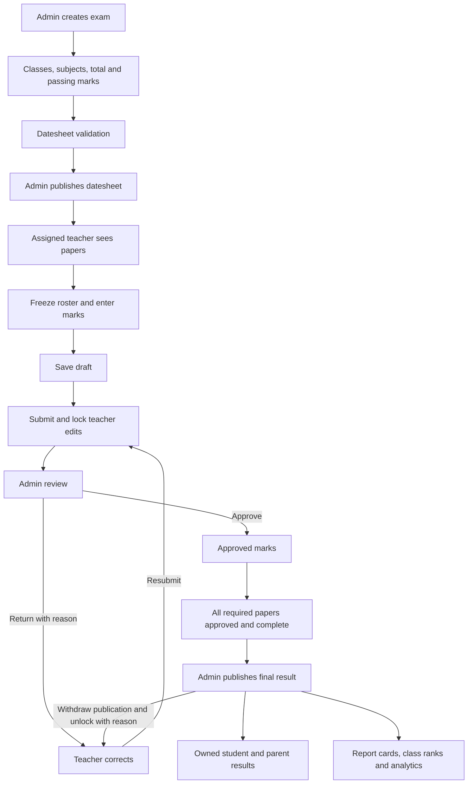

# Complete exam system: project audit and implementation plan

Audit date: 7 October 2026. This report describes the existing project before the new workflow foundation migration. Proposed routes and components below are not claims that those features already exist.

The requested workflow is: admin creates and configures an exam, publishes the datesheet, teacher saves draft marks and submits, admin returns or approves, teacher corrects returned marks and resubmits, admin publishes final results, and authorized students/parents receive final results and report cards. Approval and publication must be separate.

## Audit scope and evidence

Inspected routes/web.php, routes/teacher.php, routes/console.php, bootstrap/app.php, AppServiceProvider, authentication and login destinations, exam/quiz/student policies and requests, exam controllers/services/models, migrations, teacher exam views, shared result views, admin/teacher layouts and dashboards, notifications, grade settings and student progress queries. Live MySQL schema, indexes, foreign keys and counts were read without exposing passwords or student details. The schema snapshot is storage/app/exam-system-audit.json.

The installed project is Laravel 12 with Spatie permissions, Laravel database notifications and DomPDF. Equivalent exam, marks, grade and audit stores already exist. No parent authorization relationship or frozen examination roster exists in the inspected application schema. No AGENTS.md was found in the workspace.

Live data at audit: 2 exams, 2 exam subjects, 2 schedules, 4 quizzes, 12 saved result rows, 6 grade bands, 1 exam-settings record, 4 schedule log rows and 1 database notification. Two linked quizzes and six linked result rows are the previously requested demo fixtures. One active student is missing enrollment data; one section is flagged by the existing suspect-section heuristic. These records require review, not automatic correction.

## A. What already works

- Admin/Principal exam CRUD for eligible current-session drafts; classes use exam_classes instead of repeated exam records.
- Active class subject configuration, total/passing mark validation, copy/duplicate setup and protected deletion.
- Admin datesheet save/edit/copy, exam date bounds, time validation, Sunday/holiday overrides and class/section, room and teacher/invigilator overlap checks.
- Unique exam-subject/section schedule and linked-quiz constraints.
- Publication checklist, database notifications, confirmed datesheet updates and old/new schedule audit values.
- Teacher schedules require a published datesheet, active teacher profile, schedule ownership and matching class/section/subject/session assignment.
- Admin datesheet print/PDF and existing theme/responsive shell.
- Normal independent teacher quizzes have marks entry, absence/exemption handling, draft/finalize, grade lookup, statistics, competition ranking and CSV/PDF exports.
- Shared grade_scales configuration validates complete coverage; GradeScale::forPercentage is reused by quiz results.
- Admin assessment reports and individual student/assessment result rows, search/filter/pagination. Teacher result reports check class/section/subject/session assignment.

The preceding verification run passed 31 tests and 288 assertions across ExamSetupTest, ExamScheduleTest and TeacherQuizTest. The saved demo's admin/teacher exam, schedule and report endpoints returned expected content. Linked-exam marks UI returned 403, as the existing policy intentionally requires.

## B. What is partially implemented

- exam_schedules has marks_status and return_reason; labels support submitted/returned/approved, but no transition service, reviewer buttons or submission routes exist.
- quizzes.exam_subject_id links to configured exam subjects; publication does not automatically create the linked assessments. The two existing linked assessments were manually created demo fixtures.
- quiz_results.locked_at exists but no exam lock/unlock workflow uses it.
- Existing result reports show individual subjects rather than a combined student examination result.
- exam_settings contains pass rules, overall threshold, default marks window and report/signature settings; combined examination calculations and deadline enforcement are missing.
- Current live pass_rule is both with overall threshold 50%; absent_counts_as_fail is true. The settings controller currently forces absence-as-fail off on save. This inconsistency needs an intentional policy decision in implementation, while preserving the current saved school settings.
- Existing schedule audits and finalized quiz mark-change audits cover part of the required history, not the full examination lifecycle.
- Existing dashboards are general school/teacher dashboards and have no complete exam-specific submission/approval counters.

## C. What is missing

Dedicated teacher linked-exam marks entry and CSV workflow; immutable enrollment roster; draft/submit/resubmit transitions; admin review/return/approve/unlock; reviewer reasons and actor timestamps; final publication prerequisites; combined results; published rankings and ties; stable published grading/pass-rule snapshots; student/parent login and verified ownership access; public/internal remarks separation; school report-card identity settings; report-card PDF/print; exam performance dashboards; marks deadlines/late-submission permission; scheduled reminder deduplication; complete lifecycle audits; all requested end-to-end security tests.

## D. What should be modified

1. Add a dedicated linked-exam marks workflow. Keep the legacy quiz-edit/marks bypass blocked by QuizPolicy.
2. Add an explicit schedule-to-quiz relation and reuse quiz_results as the sole marks store.
3. Freeze examination rosters before accepting marks so student promotion, section changes or deactivation cannot alter historical results.
4. Enforce assigned schedule owner as well as all four assignment dimensions for teacher marks requests. Assignment-only access in the generic report is insufficient for the new strict owner requirement.
5. Introduce publication gates in ExamReportController, QuizPolicy/quiz view/export queries, StudentProgressService and relevant dashboard aggregates. Existing report/progress queries can reveal linked exam marks before final publication.
6. Separate exam lifecycle, schedule publication, marks approval and final result publication. A label or disabled button is not a server-side transition check.
7. Extend admin/teacher dashboards and sidebars within the current theme.
8. Improve CSV validation: current parser lacks duplicate checks, the requested roll_number/status format and blank absent marks; it is a preview parser, not a complete atomic exam import.
9. Add Student/Parent authentication destinations and explicit ownership policies. The current login rejects both roles, and StudentPolicy does not authorize either role. family_id, phone or guardian text are not safe substitutes for a verified parent-student relationship.
10. Preserve published result meaning when grade bands or pass rules subsequently change. Unlocking published marks must first withdraw publication and invalidate final snapshots/ranks, require a reason and record the action.

## E. What should NOT be changed

Reuse exams, exam_classes, exam_subjects, exam_schedules, quizzes, quiz_results, quiz_result_audits, exam_logs, grade_scales, notifications and existing people/academic tables. Do not build parallel exam_results/exam_result_items marks stores. Preserve independent quiz behavior, current school grade bands and saved school settings, existing authentication protections, role boundaries, UI shell and unrelated modules. Never rerun old migrations destructively, reset school data or silently approve/publish existing marks. Existing demo marks are fixtures, not submitted/approved evidence.

## F. Database changes required

Phase 1 foundation:

- exams: description; independent result_published_at/result_published_by; result_settings_snapshot; result_publication_version.
- exam_schedules: marks_deadline, allow_late_submission, submitted_at/submitted_by, reviewed_at/reviewed_by, roster_frozen_at. Reuse marks_status and return_reason rather than add a second submission table.
- quizzes: unique nullable exam_schedule_id; backfill only exact existing exam_subject_id/section_id matches. Preserve the existing unique subject/section constraint and legacy quiz rows.
- exam_roster_entries: new missing concept, containing quiz/student membership and original admission number, name and roll number. Unique quiz/student constraint. It contains no duplicate marks.
- exam_logs: allow an exam-level action without a schedule; add nullable exam_id while preserving existing schedule logs and actor/old/new values.

Later phases: public teacher/principal remarks must be distinct from internal reasons; student/parent ownership needs a verified pivot; school branding requires a small settings store only if no equivalent exists. Combined totals derive from approved quiz_results. Add stable publication snapshots only as required for reproducible report cards; any snapshot is derived published output, not another editable marks store.

## G. Routes required

Existing admin /exams CRUD, subject/configuration, settings, integrity, schedule save/copy/publish/preview/pdf and quiz-report routes remain.

| Role | Proposed method/path | Purpose |
| --- | --- | --- |
| Teacher | GET /teacher/exams/marks | Assigned papers filtered by marks status |
| Teacher | GET, PUT /teacher/exams/papers/{schedule}/marks | View and save draft marks |
| Teacher | POST /teacher/exams/papers/{schedule}/marks/import | Validate/import CSV within frozen roster |
| Teacher | POST /teacher/exams/papers/{schedule}/submit | Submit/resubmit with confirmation |
| Admin | GET /exams/approvals | Review queue and completeness |
| Admin | GET /exams/papers/{schedule}/review | Detailed student mark review |
| Admin | POST /exams/papers/{schedule}/return | Return with mandatory reason |
| Admin | POST /exams/papers/{schedule}/approve | Approve submitted marks |
| Admin | POST /exams/papers/{schedule}/unlock | Reopen with mandatory reason |
| Admin | GET /exams/{exam}/results | Combined result list and previews |
| Admin | POST /exams/{exam}/results/publish | Confirm and publish only complete approved results |
| Admin | POST /exams/{exam}/results/unpublish | Withdraw published results with audit reason |
| Authorized users | GET /exams/{exam}/students/{student}/result | Owned or permitted student result |
| Authorized users | GET /exams/{exam}/students/{student}/report-card/{format} | Policy-protected print/PDF |
| Admin | GET /exams/{exam}/reports/{scope} | Class/subject/statistical reports |
| Student/Parent | GET /portal/results | Only owned published exam results |

Mutations require auth, role/policy checks, CSRF, validated state and transaction locks. Static paths must precede resource parameter routes. Existing generic assessment reports remain for independent quizzes; exam finals need their own publication-gated presentation.

## H. Controllers and services required

Extend ExamController, ExamScheduleController, Teacher/ExamController, ExamSettingsController and ExamReportController. Add Teacher/ExamMarksController, ExamApprovalController, ExamPublicationController, ExamReportCardController and Portal/ExamResultController as their phases arrive.

Reuse ExamSetup, ExamDatesheet, ExamIntegrity and GradeScale. Add ExamRoster, ExamMarksWorkflow, ExamResults and ExamAnalytics services with centralized ownership/state checks. Extend authentication login/destinations only when portal access has ownership tests. Add an idempotent scheduled reminder command later.

## I. Models and relationships required

Existing: Exam belongs to session/creator, belongs to many classes and has subjects; subjects belong to exam/class/subject and have schedules/quizzes; schedules belong to section/teacher/invigilator; quizzes have results/audits; results belong to student/assessment/entry user; users have teacher profiles and notifications.

Foundation additions: Quiz belongs to ExamSchedule; ExamSchedule has one Quiz and roster/submission/reviewer metadata; Quiz has many ExamRosterEntry records; roster entry belongs to Quiz and Student including soft-deleted historical students; Exam has schedules via subjects, logs and publication actor. ExamLog belongs to exam, optional schedule and actor. Later Student belongs to its existing portal user, and verified parent users link through an explicit many-to-many relationship.

## J. Views required

Retain existing exam editor/detail, datesheet builder/list/print, shared grade editor, admin/teacher layouts and navigation. Add teacher assigned marks queue/editor/CSV preview/submission confirmation; admin approval queue/review/return/unlock; combined exam/class/subject result pages; publication checklist/confirmation; student result detail; shared report-card print/PDF; portal result list; exam analytics. Add teacher/admin exam summary cards. Reuse typography, colors, tables and responsive scrolling. Keep internal review reasons outside student/parent outputs.

## K. Complete workflow diagram

State definitions: exam retains its existing draft/scheduled/marks_entry/published lifecycle for compatibility; datesheet visibility uses datesheet_published_at; schedule marks_status uses not_started/draft/submitted/returned/approved (resubmission returns to submitted and is audited); final visibility uses a separate result_published_at. Approval never publishes results automatically.

Calculations use configured subject passing marks and pass_rule/overall threshold. Absent marks remain NULL; absent outcomes are explicit and any school absence-as-fail configuration must be honored deliberately. Only complete approved/published results may receive final ranks; ties use competition ranks such as 1,1,3. Draft/returned/unapproved results must never be ranked as finals.

## Implementation sequence and test plan

Implement the user's 16 phases sequentially. Phase 1 supplies schema/relationships; phases 2–4 extend the working exam/datesheet/teacher display; phases 5–8 implement entry/submission/review/correction; phases 9–12 implement totals/publication/owned portal/report cards; phases 13–15 add analytics/reminders/lifecycle history; phase 16 completes authorization/regression checks. Add authorization and transactional tests during each relevant phase, not only at the end.

For each phase document what is built, why, changed/new files, involved tables, admin/teacher actions, button behavior, data movement and a test procedure. Exercise all 12 requested scenarios plus historical roster retention, concurrent submits/reviews, publication blocking, stale approval after corrections, CSV duplicates, deadline enforcement, portal ownership and non-disclosure of draft marks/internal comments.
