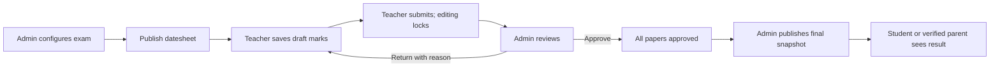

# Complete examination system replacement

Implemented 7 October 2026. The examination interface and linked exam workflow now follow the attached Admin → Teacher requirements. Existing school records were preserved; exam setup, marks and publication share one linked data path. Independent quizzes remain available through their existing routes, while linked examinations cannot use those routes to bypass review.

## Use the system

1. Admin: Examinations → Exams → create exam → select classes and subjects → configure total/passing marks.
2. Admin: Exam Schedule → save schedules/deadlines → publish datesheet.
3. Teacher: Examinations → Enter Marks → enter or import marks → Save Draft → Submit Marks.
4. Admin: Result Approval → Review → Return with reason or Approve.
5. Teacher: Returned Marks → correct → Save Draft → Resubmit.
6. Admin: Publish Results → resolve checklist → Publish Result.
7. Admin: Reports → Portal Access → verify Student/Parent account links. Families log in and use their Results portal.
8. Admin/authorized family: Exam Results → Report Card → Print or PDF.

## Phase explanations

### Phase 1: Database relationships

1. **What was built:** One scheduled paper has one linked assessment and a frozen student roster.
2. **Why it is needed:** Stops duplicate assessments and changing student identities after marks entry.
3. **Existing files changed:** Exam, ExamSchedule, Quiz, QuizResult, ExamSetting, User models.
4. **New files:** ExamRosterEntry, ExamLog; workflow foundation and completion migrations.
5. **Tables involved:** exams, exam_schedules, quizzes, quiz_results, exam_roster_entries, exam_logs.
6. **Admin action:** Keeps existing school records and configures exams.
7. **Teacher action:** Uses the roster linked to the assigned paper.
8. **Button behavior:** Opening marks entry freezes eligible student identities.
9. **Data movement:** Exam → subject → scheduled paper → linked quiz → roster → marks.
10. **How to test:** Open marks, change a student's current roll/class, and verify the original exam identity remains.

### Phase 2: Admin exam management

1. **What was built:** Exam creation, description, dates, type and class/subject configuration.
2. **Why it is needed:** Admin controls the assessment structure.
3. **Existing files changed:** ExamController, ExamSetup, exam editor.
4. **New files:** No separate parallel exam setup module.
5. **Tables involved:** exams, exam_subjects, academic_sessions, classes, subjects.
6. **Admin action:** Creates an exam and includes subjects with total and passing marks.
7. **Teacher action:** Cannot create or change examination setup.
8. **Button behavior:** Save validates and records the setup.
9. **Data movement:** Current academic session → exam → configured subjects.
10. **How to test:** Create an exam; attempt passing marks above total and verify rejection.

### Phase 3: Datesheet management

1. **What was built:** Scheduling, rooms, invigilators, deadlines, publication and printable datesheet.
2. **Why it is needed:** Teachers need approved timings and assigned responsibility.
3. **Existing files changed:** ExamDatesheet, ExamScheduleController, schedule dialog.
4. **New files:** Existing schedule views extended.
5. **Tables involved:** exam_schedules, exam_subjects, teacher_assignments, exam_settings.
6. **Admin action:** Saves schedules, resolves checklist errors and publishes.
7. **Teacher action:** Sees papers only after datesheet publication.
8. **Button behavior:** Publish validates the datesheet and makes assigned schedules visible.
9. **Data movement:** Subjects and teacher assignments → scheduled papers → published datesheet.
10. **How to test:** Try conflicting or incomplete schedules; inspect the checklist and print a valid datesheet.

### Phase 4: Teacher schedule

1. **What was built:** My Examinations, My Schedule and exam dashboard counts.
2. **Why it is needed:** Teachers can find upcoming and pending papers.
3. **Existing files changed:** Teacher ExamController, dashboard, sidebar and schedule views.
4. **New files:** teacher/exams/summary.blade.php.
5. **Tables involved:** exam_schedules, exams, teacher_assignments.
6. **Admin action:** Publishes datesheet and assigns papers.
7. **Teacher action:** Opens the schedule and Enter Marks link.
8. **Button behavior:** Enter Marks checks teacher ownership before showing the roster.
9. **Data movement:** Published schedule → owned teacher queue → marks editor.
10. **How to test:** Log in as another teacher and confirm the paper cannot be edited.

### Phase 5: Marks entry

1. **What was built:** Roster-based marks, Present/Absent, public subject remarks and validated CSV.
2. **Why it is needed:** Records marks without duplicate result storage.
3. **Existing files changed:** QuizResult model, app.js, exams.css.
4. **New files:** ExamWorkflow, Teacher/ExamMarksController, teacher/exams/marks.blade.php.
5. **Tables involved:** quiz_results, exam_roster_entries, quiz_result_audits.
6. **Admin action:** Defines limits and submission deadline.
7. **Teacher action:** Enters marks or imports CSV.
8. **Button behavior:** Save validates the whole request; invalid data rolls back.
9. **Data movement:** Frozen roster → validated marks → draft results.
10. **How to test:** Try negative, excessive, nonnumeric marks and mismatched CSV IDs; mark Absent and verify NULL marks.

### Phase 6: Draft and submit

1. **What was built:** Editable drafts and locked submissions.
2. **Why it is needed:** Teachers can work before sending completed marks for review.
3. **Existing files changed:** ExamSchedule relationships, teacher routes, sidebar.
4. **New files:** teacher/exams/marks-index.blade.php.
5. **Tables involved:** quiz_results, exam_schedules, notifications.
6. **Admin action:** Receives submitted papers in the approval queue.
7. **Teacher action:** Saves drafts, then confirms Submit Marks.
8. **Button behavior:** Submit requires every roster student to have valid marks or Absent, then locks editing.
9. **Data movement:** Draft → complete validation → Submitted → admin notification.
10. **How to test:** Submit incomplete marks and verify rejection; complete them and verify editing is locked.

### Phase 7: Admin approval

1. **What was built:** A read-only paper review and approval queue.
2. **Why it is needed:** Submission needs verification before publication.
3. **Existing files changed:** web routes and exam sidebar.
4. **New files:** ExamManagementController, exams/approvals.blade.php, exams/review.blade.php.
5. **Tables involved:** exam_schedules, quiz_results, exam_logs.
6. **Admin action:** Reviews student marks and approves submitted papers.
7. **Teacher action:** Sees approval status without editing approved marks.
8. **Button behavior:** Approve verifies completeness and records the reviewer.
9. **Data movement:** Submitted → admin review → Approved.
10. **How to test:** Approve both papers; verify the final student result is still unpublished.

### Phase 8: Return and resubmit

1. **What was built:** Required correction reason, teacher correction and resubmission.
2. **Why it is needed:** Mistakes need a traceable correction cycle.
3. **Existing files changed:** ExamWorkflow and review/marks views.
4. **New files:** No duplicate correction tables.
5. **Tables involved:** exam_schedules, quiz_results, exam_logs, notifications.
6. **Admin action:** Returns submitted marks with a reason; can unlock approved marks with a reason.
7. **Teacher action:** Reads the reason, corrects marks, saves and resubmits.
8. **Button behavior:** Return reopens editing; resubmit locks it again.
9. **Data movement:** Submitted → Returned → Draft correction → Resubmitted → Approved.
10. **How to test:** Return without a reason is rejected; return with a reason and complete the correction cycle.

### Phase 9: Combined calculation

1. **What was built:** Student totals, percentages, grades, pass rules and tied positions.
2. **Why it is needed:** Final results combine every configured subject.
3. **Existing files changed:** ExamSetting and grades integration.
4. **New files:** ExamResults service, exams/combined-results.blade.php.
5. **Tables involved:** exam_settings, grade_scales, quiz_results, exam_student_comments.
6. **Admin action:** Configures grading and overall/subject pass rules.
7. **Teacher action:** Can view published marks for owned subjects.
8. **Button behavior:** Preview calculates approved combined data; final publication assigns eligible ranks.
9. **Data movement:** Approved subject marks → student totals → pass rule → grade/rank.
10. **How to test:** Check tied marks produce positions 1,1,3; verify Absent has no rank and remains ABS.

### Phase 10: Publication

1. **What was built:** Separate final result publication with an immutable snapshot.
2. **Why it is needed:** Approval and publication are different decisions.
3. **Existing files changed:** Exam model and workflow controllers.
4. **New files:** exams/publications.blade.php.
5. **Tables involved:** exams, quizzes, exam_settings, grade_scales, notifications.
6. **Admin action:** Publishes only after the full approval checklist succeeds.
7. **Teacher action:** Cannot publish results.
8. **Button behavior:** Publish snapshots identities, marks, grades, remarks and school branding; unlock withdraws publication.
9. **Data movement:** Approved papers → publication checklist → frozen final snapshot.
10. **How to test:** Block publication with a pending paper; publish complete results; change grades and verify the published result stays unchanged.

### Phase 11: Student/parent portal

1. **What was built:** Verified account links and access to owned published results.
2. **Why it is needed:** Families must not see drafts or another child's record.
3. **Existing files changed:** LoginController, LoginDestination, StudentController, auth routes.
4. **New files:** ExamPortalController, layouts/portal, portal/results, exams/portal-access.
5. **Tables involved:** users, students, parent_student, exams.
6. **Admin action:** Creates or links Student/Parent accounts through Reports → Portal Access.
7. **Teacher action:** Does not manage portal ownership.
8. **Button behavior:** Save verifies the requested role and student link; portal reads only permitted published rows.
9. **Data movement:** Verified account → owned students → published snapshots.
10. **How to test:** Use one student's account and another child's URL; verify 403. Test a verified parent's permitted child.

### Phase 12: Report card

1. **What was built:** School-branded subject report card with print/PDF and public remarks.
2. **Why it is needed:** Provides a stable document for families.
3. **Existing files changed:** Exam settings and result controller.
4. **New files:** exams/report-card.blade.php.
5. **Tables involved:** exams.result_snapshot, exam_settings, exam_student_comments, student_attendances.
6. **Admin action:** Sets branding and public teacher/principal remarks before publication.
7. **Teacher action:** Enters public subject feedback while editing.
8. **Button behavior:** PDF renders the permitted student's published snapshot.
9. **Data movement:** Final snapshot → authorized report card → printable HTML/PDF.
10. **How to test:** Open Show, Print and PDF; verify marks, ABS, totals, signatures and private review reasons remain private.

### Phase 13: Analytics

1. **What was built:** Class totals, subject performance, combined CSV and print reports.
2. **Why it is needed:** Admin can review exam outcomes and pending work.
3. **Existing files changed:** ExamManagementController.
4. **New files:** exams/reports.blade.php, exams/dashboard.blade.php.
5. **Tables involved:** exams, exam_schedules, quiz_results.
6. **Admin action:** Filters reports and downloads CSV or prints.
7. **Teacher action:** Sees only owned published subject results.
8. **Button behavior:** Reports derive from the same calculation/publication source.
9. **Data movement:** Approved marks or final snapshot → aggregate report → CSV/print.
10. **How to test:** Filter a class/section and reconcile totals with combined student results.

### Phase 14: Notifications and deadlines

1. **What was built:** Database notifications for submission/review/publication and scheduled reminders.
2. **Why it is needed:** Keeps the next responsible person informed.
3. **Existing files changed:** routes/console.php, ExamWorkflow, ExamDatesheet.
4. **New files:** ExamWorkflowUpdated notification, reminder command.
5. **Tables involved:** notifications, exam_reminders, exam_schedules.
6. **Admin action:** Sets deadlines and explicit late-submission permission.
7. **Teacher action:** Receives review and deadline notices.
8. **Button behavior:** Workflow actions notify recipients; hourly reminders are deduplicated.
9. **Data movement:** State/deadline → eligible recipient → database notification.
10. **How to test:** Run php artisan exams:remind twice and verify reminders are not duplicated. Run the Laravel scheduler for ongoing reminders.

### Phase 15: Audit

1. **What was built:** Actor, time, action, previous/new values and correction reasons.
2. **Why it is needed:** Explains who changed marks and why.
3. **Existing files changed:** ExamSetup, workflow, settings and portal controllers.
4. **New files:** ExamLog model and review history display.
5. **Tables involved:** exam_logs, quiz_result_audits.
6. **Admin action:** Reads history while reviewing marks.
7. **Teacher action:** Cannot change audit history.
8. **Button behavior:** Every relevant transition records its actor and details.
9. **Data movement:** Authorized mutation → marks/workflow record → audit record.
10. **How to test:** Complete return/resubmit/approve/publish/unlock and inspect the review history.

### Phase 16: Security and verification

1. **What was built:** Role/assignment/ownership checks, atomic validation and responsive interface verification.
2. **Why it is needed:** Prevents cross-teacher edits, legacy bypasses and private result leakage.
3. **Existing files changed:** QuizPolicy, QuizService, StudentProgressService; existing exam tests.
4. **New files:** tests/Feature/ExamWorkflowTest.php; demo workflow and browser verification scripts.
5. **Tables involved:** All workflow tables; automated tests use isolated test data.
6. **Admin action:** Uses admin-only setup/review/publication controls.
7. **Teacher action:** Uses only assigned papers; linked legacy quiz editor is forbidden.
8. **Button behavior:** Unauthorized actions return 403; invalid transitions return validation errors.
9. **Data movement:** Request → role/ownership check → transaction → mutation → audit.
10. **How to test:** Full suite: 164 tests passed before final targeted changes; final focused suite: 23 tests passed. Demo: 11 HTTP/PDF/access checks passed. Desktop/mobile: 6 screen checks passed with zero JS exceptions.

## Demo and verification

The dedicated demo exam is `DEMO CHECK - October 2026 Exam` (exam ID 2). Its two papers were saved, submitted, returned/resubmitted, approved and published through the authorized workflow. Three combined results were produced. The existing per-subject sample CSV was preserved.

- `storage/app/demo-combined-exam-results.csv`: final combined sample results.
- `storage/app/demo-final-report-card.pdf`: final sample report card.
- `storage/app/demo-exam-check.json`: workflow and HTTP verification results.
- `storage/app/exam-ui-check.json`: desktop/mobile checks, icons, single active indicator and JS exceptions.
- `storage/app/exam-replacement-regression.txt`: full regression output.
- `storage/app/exam-final-focused-tests.txt`: final focused validation output.

Database completion migration has been applied to the local database. Vite production build and Blade compilation pass. For automatic deadline reminders, keep `php artisan schedule:work` running locally, or configure the hosting scheduler to run `php artisan schedule:run` every minute. The command is scheduled hourly and deduplicates recipients/papers each day.

## Corrections after publication

Admin must unlock a paper with a reason. This withdraws the exam's published result and removes family access while corrections are pending. The teacher corrects and resubmits; Admin reapproves and republishes a new snapshot version. Existing published cards are never silently recalculated using later grade changes.

